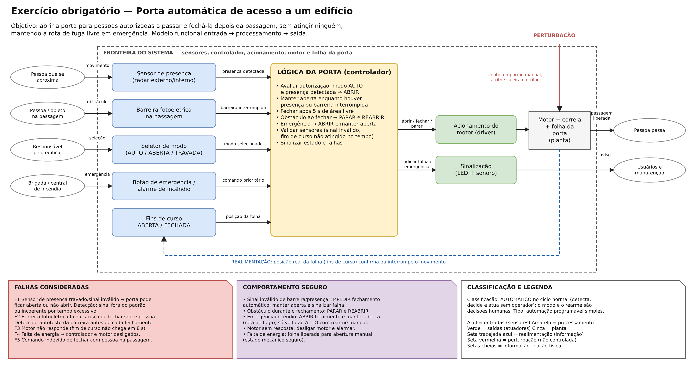
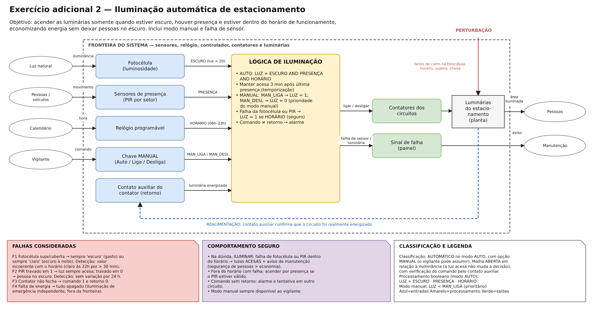
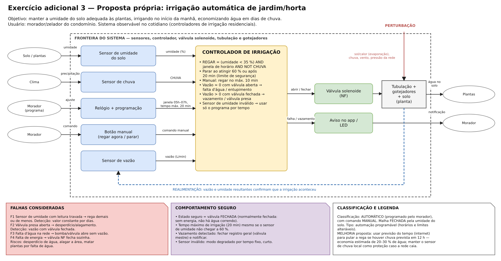

# Semana 1 — Fundamentos dos sistemas automatizados

**UC Sistemas Automatizados** · Prof. Calvetti · Engenharia de Software — USJT

**Aluno:** Gustavo Nunes Modesto
(RA 823126987) · 

**Data:** 20/08/2026

## Conteúdo desta pasta

| Arquivo | Conteúdo |
|---|---|
| `diagramas.drawio` | Arquivo **editável** do diagrams.net com 4 páginas, uma para cada exercício |
| `porta-automatica.png` | Exercício obrigatório — porta automática |
| `reservatorio.png` | Exercício adicional 1 — controle de nível |
| `iluminacao.png` | Exercício adicional 2 — iluminação de estacionamento |
| `proposta-propria-irrigacao.png` | Exercício adicional 3 — proposta própria (irrigação automática) |

Para editar os diagramas, acesse <https://app.diagrams.net> → *Arquivo → Abrir de → Dispositivo* → `diagramas.drawio`. Cada exercício está em uma página, disponível nas abas inferiores.

**Convenções utilizadas nos diagramas** (slide 56): seta de entrada = entrada; bloco com verbo = processamento; seta de saída = saída; seta lateral vermelha = perturbação; nota = falha; seta tracejada azul = realimentação. As cores seguem o padrão: azul para sensores/entradas, amarelo para processamento, verde para atuadores/saídas e cinza para a planta.

---

## Exercício obrigatório — Porta automática de acesso a um edifício

### Objetivo

Permitir a abertura automática da porta quando uma pessoa se aproxima e realizar o fechamento após sua passagem, evitando o fechamento sobre pessoas e mantendo a rota de fuga disponível em situações de emergência.

### Fronteira do sistema

- **Dentro:** sensores de presença, barreira fotoelétrica, fins de curso, seletor de modo, botão de emergência, controlador (lógica da porta), acionamento do motor, motor, correia, folha da porta e sinalização.
- **Fora:** pessoas, brigada/central de incêndio, rede elétrica do edifício, vento e condições do ambiente.

### Classificação

O funcionamento normal é **automático**, pois o sistema identifica a presença de pessoas, toma decisões e executa os movimentos sem intervenção humana.

A seleção dos modos (AUTO / ABERTA / TRAVADA) e o rearme após uma emergência dependem de **decisões humanas**.

O sistema utiliza automação **programável** simples, permitindo configurar tempos e modos de funcionamento no controlador.

### Entradas, processamento e saídas

| Tipo | Elemento | Sinal / significado |
|---|---|---|
| Entrada | Sensor de presença (radar) | presença detectada |
| Entrada | Barreira fotoelétrica na passagem | barreira interrompida (obstáculo) |
| Entrada | Seletor de modo | AUTO / ABERTA / TRAVADA |
| Entrada | Botão de emergência / alarme de incêndio | comando prioritário |
| Entrada (realimentação) | Fins de curso ABERTA / FECHADA | posição real da folha |
| Processamento | Lógica da porta | verificar autorização, decidir abrir/manter/fechar e identificar falhas |
| Saída | Acionamento do motor | abrir / fechar / parar |
| Saída | Sinalização (LED + sonoro) | indicar falha e emergência |

**Regras de processamento**

1. Modo AUTO **e** presença detectada → ABRIR.
2. Manter a porta aberta enquanto houver presença **ou** a barreira estiver interrompida.
3. Fechar após 5 s com a área livre.
4. Obstáculo durante o fechamento → PARAR e REABRIR.
5. Emergência → ABRIR e manter aberta, com prioridade sobre as demais regras.
6. Fim de curso não atingido em 8 s ou sinal inválido de sensor → falha.

### Realimentação, perturbação e falha

- **Realimentação:** os fins de curso informam a posição real da porta. O controlador só considera a porta aberta ou fechada após a confirmação do respectivo fim de curso. Caso o sinal não seja recebido no tempo previsto, o movimento é interrompido.
- **Perturbação:** vento, movimentação manual da folha, atrito ou sujeira no trilho.
- **Falha principal:** sensor de presença ou barreira fotoelétrica apresentando sinal inválido ou travado.

### Comportamento seguro

- Sinal inválido da barreira ou do sensor de presença → **bloquear o fechamento automático**, manter a porta aberta e sinalizar a falha.
- Obstáculo durante o fechamento → **parar e reabrir**.
- Emergência/incêndio → **abrir completamente e manter aberta**, garantindo a rota de fuga. O retorno ao modo AUTO exige rearme manual.
- Motor sem resposta → desligar o motor e acionar o alarme.
- Falta de energia → liberar a folha para abertura manual, mantendo um estado mecânico seguro.

### Casos de teste e resultados

A validação foi realizada analisando o comportamento do modelo em diferentes cenários (slide 60):

| Cenário | Entrada | Resposta esperada | Resposta do modelo | Situação |
|---|---|---|---|---|
| Aproximação válida | Presença detectada (modo AUTO) | Abrir porta | Regra 1 → ABRIR | Aprovado |
| Passagem concluída | Área livre por 5 s | Fechar após espera | Regra 3 → FECHAR | Aprovado |
| Obstáculo | Barreira interrompida durante fechamento | Parar e reabrir | Regra 4 → PARAR + ABRIR | Aprovado |
| Falha de sensor | Sinal inválido da barreira | Impedir fechamento automático | Estado seguro → mantém aberta + alarme | Aprovado |
| Emergência | Comando prioritário | Adotar estado seguro | Regra 5 → ABRIR e manter aberta | Aprovado |
| Motor não responde | Comando ABRIR sem fim de curso em 8 s | Parar e alarmar | Regra 6 → motor OFF + sinalização | Aprovado |

---

## Exercício adicional 1 — Reservatório (controle de nível)

- **Objetivo:** manter o nível do reservatório entre 30 % e 80 %, evitando transbordamento e funcionamento a seco.
- **Classificação:** sistema automático de **malha fechada**, no qual o nível medido determina o acionamento da bomba.
- **Elementos:** planta = reservatório e tubulações; sensor = transmissor de nível (+ chaves ALTO-ALTO e BAIXO-BAIXO independentes); controlador = lógica de nível; atuador = bomba; perturbação = variação do consumo.
- **Setpoint:** a bomba liga quando o nível fica abaixo de 30 % e desliga ao atingir 80 %. Os **dois limites** estabelecem uma faixa de funcionamento estável, evitando acionamentos e desligamentos frequentes.
- **Falhas:** transmissor travado (baixo ou alto), sinal fora da faixa, bomba sem resposta e **nível alto-alto**.
- **Estado seguro:** nível alto-alto ou sensor inválido → bomba desligada + alarme, sem religamento automático após a falha.

| Caso | Nível / condição | Estado anterior da bomba | Esperado | Situação |
|---|---|---|---|---|
| R1 | 25 % | desligada | liga | Aprovado |
| R2 | 50 % | ligada | continua ligada (histerese) | Aprovado |
| R3 | 80 % | ligada | desliga | Aprovado |
| R4 | 50 % | desligada | continua desligada | Aprovado |
| R5 | LSHH ativo (95 %) com transmissor indicando 60 % | ligada | desliga + alarme de incoerência | Aprovado |
| R6 | Transmissor indica 120 % (inválido) | qualquer | bomba OFF + alarme de falha | Aprovado |

## Exercício adicional 2 — Iluminação automática de estacionamento

- **Entradas:** luminosidade (ESCURO), presença (PRESENÇA), horário (HORÁRIO) e chave manual.
- **Processamento booleano (AUTO):** `LUZ = ESCURO AND PRESENÇA AND HORÁRIO`, mantendo a iluminação por 3 min após a última presença.
- **Modo manual:** `MAN_LIGA` acende e `MAN_DESL` apaga as luzes, tendo prioridade sobre o modo automático.
- **Falha de sensor:** durante o horário de funcionamento, caso a fotocélula ou o sensor PIR apresente sinal inválido, as luzes permanecem **acesas** e um aviso é emitido, priorizando a segurança das pessoas.

| Caso | ESCURO | PRESENÇA | HORÁRIO | Modo | Esperado | Situação |
|---|---|---|---|---|---|---|
| L1 | 1 | 1 | 1 | AUTO | LUZ = 1 | Aprovado |
| L2 | 0 | 1 | 1 | AUTO | LUZ = 0 (dia claro) | Aprovado |
| L3 | 1 | 0 | 1 | AUTO | LUZ = 0 após 3 min sem presença | Aprovado |
| L4 | 1 | 1 | 0 | AUTO | LUZ = 0 (fora do horário) | Aprovado |
| L5 | qualquer | qualquer | qualquer | MAN_LIGA | LUZ = 1 | Aprovado |
| L6 | fotocélula inválida | 1 | 1 | AUTO | LUZ = 1 + aviso de falha | Aprovado |

## Exercício adicional 3 — Proposta própria: irrigação automática

- **Objetivo e usuário:** controlar a umidade do solo de um jardim ou horta de condomínio, sendo utilizado por moradores ou pelo zelador.
- **Grau e tipo de automação:** funcionamento automático com possibilidade de comando manual; automação programável, com horários e limites ajustáveis; controle em malha fechada pela umidade do solo.
- **Modelo E–P–S:** umidade, chuva, relógio, botão manual e vazão → controlador → válvula solenoide e aviso.
- **Perturbações:** incidência solar/evaporação, chuva, vento e variações na pressão da rede.
- **Riscos e estado seguro:** válvula travada aberta (desperdício ou alagamento), sensor travado e falta d'água. O estado seguro utiliza **válvula normalmente fechada**, limite máximo de irrigação de 20 min e fechamento da válvula mestre em caso de vazamento.
- **Melhoria proposta:** consultar a previsão do tempo para suspender a irrigação quando houver previsão de chuva nas próximas 12 h. O sensor de chuva local continua funcionando como proteção caso ocorra falha na conexão com a internet. Essa solução busca reduzir o consumo de água sem comprometer a proteção local.

---

## Matriz mínima de riscos (porta automática)

| Falha | Efeito | Detecção | Resposta segura |
|---|---|---|---|
| Sensor de presença travado | Porta não abre ou não fecha | Sinal sem variação por tempo excessivo (incoerência temporal) | Bloquear fechamento automático, manter aberta e sinalizar |
| Barreira fotoelétrica com defeito | Risco de fechar sobre uma pessoa | Autoteste da barreira antes de cada fechamento | Impedir fechamento e sinalizar manutenção |
| Perda de energia | Parada do sistema | Ausência de alimentação | Folha liberada para abertura manual (estado mecânico seguro) |
| Comando indevido de fechar | Fechamento com pessoa na passagem | Permissivos (barreira livre, sem presença) | Rejeitar o comando |
| Atuador não responde | Porta não abre/fecha | Realimentação: fim de curso não é atingido em 8 s | Parar o motor e acionar o alarme |

## Checklist de qualidade

- [x] Fronteira do sistema identificada (retângulo tracejado em todos os diagramas).
- [x] Todas as setas possuem identificação e significado.
- [x] Entradas e saídas estão diferenciadas por cores e posicionamento.
- [x] O processamento apresenta decisões verificáveis (regras numeradas).
- [x] Realimentação representada quando necessária (seta tracejada azul).
- [x] Falhas e estados seguros identificados (notas inferiores).
- [x] O README permite compreender os diagramas sem necessidade de explicação oral.

## Active recall (respostas próprias)

1. **Manual × semiautomático × automático:** a diferença está em quem toma a decisão e executa a ação. No sistema manual, a pessoa decide e executa (abrir um registro). No semiautomático, a pessoa autoriza e a máquina executa a sequência (uma lavadora iniciada pelo botão INICIAR). No automático, o próprio sistema identifica a condição, decide e atua (termostato de geladeira).
2. **Quando a realimentação é necessária:** quando perturbações ou variações impedem garantir o resultado apenas com uma ação fixa. Por exemplo, um ar-condicionado precisa medir a temperatura porque a quantidade de pessoas no ambiente pode variar.
3. **Sensor × atuador:** o sensor transforma uma grandeza física em informação (termômetro de um forno), enquanto o atuador transforma um comando em ação física (resistência elétrica do forno).
4. **Falha segura:** quando ocorre uma falha, o sistema deve assumir o estado que oferece menor risco, o que nem sempre significa desligar tudo. Por exemplo, em um elevador sem energia, os freios são acionados para impedir a movimentação da cabine.
5. **Software com consequência física:** um erro na lógica pode gerar comandos incorretos para atuadores reais. Por exemplo, trocar `>=` por `>` em um sistema de irrigação pode fazer a válvula permanecer aberta além do previsto, causando alagamento.

## Limitações

Os diagramas representam modelos funcionais dos sistemas. Não incluem dimensionamento de componentes nem substituem análises de risco exigidas por normas técnicas, como as aplicáveis a portas automáticas e à segurança de máquinas.

Nenhum dado real de processo industrial foi utilizado.
