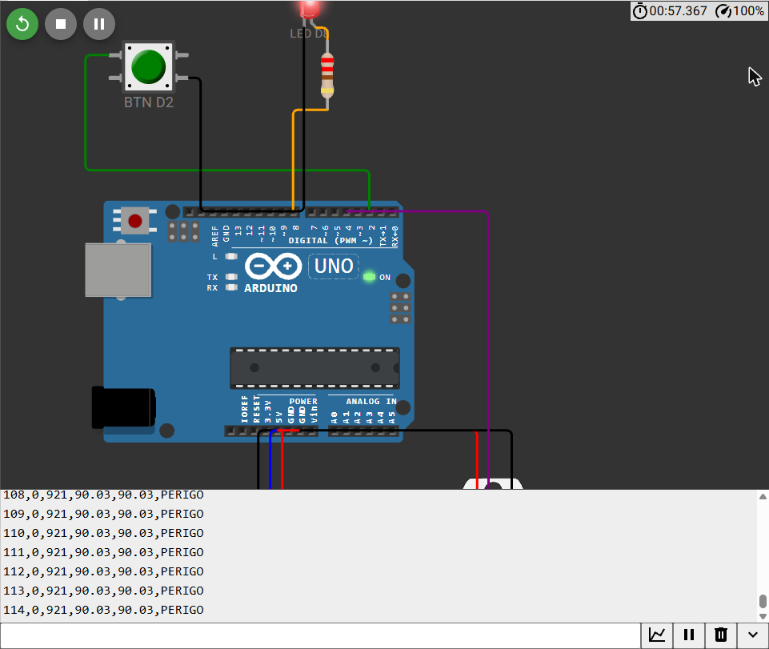

# Semana 3 — Sinais analógicos e digitais

**UC Sistemas Automatizados** · Prof. Calvetti · Engenharia de Software — USJT

**Aluno:** Gustavo Nunes Modesto
(RA 823126987) · 

**Data:** 04/09/2026

## Links

- Projeto Wokwi: [abrir simulação](https://wokwi.com/projects/478005589238822913)
- Google Planilhas: [abrir planilha](https://docs.google.com/spreadsheets/d/1YLBdpqzNJDpKwzCJlyFs-IPuvSKcwL40Cb6CQU-KXb8/edit?usp=sharing)

## Objetivo

Dar continuidade à estação de monitoramento da Semana 2, desenvolvendo as etapas de **aquisição, escalonamento, classificação e registro** de uma variável. O processo consiste em converter a leitura bruta do ADC em percentual, depois em uma grandeza de engenharia (0–100 °C), classificar o resultado em NORMAL, ATENÇÃO, PERIGO ou FALHA e registrar as informações em CSV. Os dados também são conferidos em uma planilha independente e apresentados em um gráfico de tendência.

## Estrutura

```
semana-03-sinais/
├── README.md
├── sketch.ino                 ← programa integrado (aquisição + escala + estado + CSV)
├── diagram.json               ← mesmo circuito da Semana 2
├── libraries.txt
├── etapas/
│   ├── 01-aquisicao-csv.ino   ← Etapa 2: botao,bruto
│   ├── 02-escalonamento.ino   ← Etapa 3: bruto,pct,tempC
│   └── 03-media-movel.ino     ← Exercício adicional 1
├── planilha/
│   ├── escalonamento.xlsx     ← importar no Google Planilhas
│   ├── amostras_monitor_serial.csv
│   ├── media_movel_serial.csv
│   └── grafico-tendencia.png
├── testes/casos-de-teste.md
└── evidencias/                ← capturas do Wokwi e da planilha
```

## Etapa 1 — Classificação dos sinais

| Elemento | Direção | Natureza | Papel |
|---|---|---|---|
| Pushbutton em D2 | Entrada | Discreta | comando/estado |
| Potenciômetro em A0 | Entrada | Analógica, convertida pelo ADC | variável simulada |
| DHT22 em D4 | Entrada | Digital codificada | temperatura/umidade |
| LED em D8 | Saída | Discreta | sinalização |
| Percentual calculado | Interno | Numérico | variável derivada (não é entrada física) |

## Tabela de E/S

| Tag | Endereço | Tipo | Faixa | Função |
|---|---|---|---|---|
| POT_BRUTO | A0 | AI | 0–1023 | adquirir variável |
| BTN_COMANDO | D2 | DI | HIGH/LOW | ler comando |
| LED_ALARME | D8 | DO | OFF/ON | sinalizar PERIGO |
| NIVEL_PCT | memória | REAL | 0–100 % | decidir e registrar |
| TEMP_C | memória | REAL | 0–100 °C | grandeza de engenharia |

## Conversão e escalonamento

- **ADC do Arduino Uno:** resolução de 10 bits, equivalente a 2¹⁰ = 1024 códigos (0 a 1023). O passo ideal é q = 5,00 V / 1024 ≈ 4,88 mV.
- **Percentual:** `pct = 100.0 * bruto / 1023.0`. Os valores com `.0` evitam a divisão inteira.
- **Temperatura (0–100 °C):** `tempC = 0 + pct × (100 − 0)/100 = pct`.
- **Equação geral:** utilizada na função `escalonar()`: `y = ymin + (x − xmin)·(ymax − ymin)/(xmax − xmin)`.
- **Faixas industriais simuladas na planilha:** `I = 4 + 16·p/100` para 4–20 mA e `V = 10·p/100` para 0–10 V.

| Bruto | Percentual | Temperatura | Corrente | Tensão |
|---|---|---|---|---|
| 0 | 0,000 % | 0,000 °C | 4,000 mA | 0,000 V |
| 512 | 50,049 % | 50,049 °C | 12,008 mA | 5,005 V |
| 1023 | 100,000 % | 100,000 °C | 20,000 mA | 10,000 V |

O valor bruto 512 não representa exatamente 50 %, pois a conversão utiliza a faixa de 0 a 1023. Assim, 512/1023 resulta em um valor ligeiramente superior a 0,5.

## Estados (prioridade da falha)

| Ordem | Estado | Regra |
|---|---|---|
| 1 | FALHA | percentual fora de 0–100 % |
| 2 | PERIGO | ≥ 85 % (LED_ALARME aceso) |
| 3 | ATENÇÃO | ≥ 70 % |
| 4 | NORMAL | < 70 % |

A classificação verifica primeiro a validade da leitura e depois as condições de maior para menor gravidade. O estado NORMAL é atribuído quando nenhuma condição anterior é atendida.

## Como reproduzir

1. **Wokwi:** abra o projeto da Semana 2 ou crie um novo Arduino Uno utilizando `diagram.json`. Em seguida, cole o conteúdo de `sketch.ino` e inicie a simulação. O Monitor Serial exibe `amostra,botao,bruto,pct,tempC,estado` a cada 500 ms.
2. Gire o potenciômetro lentamente do valor mínimo até o máximo e depois retorne, copiando pelo menos 10 linhas do Monitor Serial.
3. **Google Planilhas:** acesse *Arquivo → Importar → Fazer upload*, selecione `planilha/escalonamento.xlsx` e escolha *Substituir planilha*. As fórmulas são apresentadas em português (SE/OU) automaticamente.
4. Na aba `aquisicao`, as colunas **A (amostra), B (bruto_ADC) e H (estado_serial)** recebem os dados copiados do Monitor Serial. As outras colunas utilizam fórmulas. A coluna `confere` compara o estado calculado pela planilha com o resultado do Arduino. Nas 31 amostras verificadas, todos os resultados foram OK.
5. Compartilhe a planilha com a opção *Qualquer pessoa com o link → Leitor* e o projeto Wokwi por meio de *Save → Share*. Os links estão disponíveis no início deste README.

### Abas da planilha

| Aba | Conteúdo |
|---|---|
| `aquisicao` | amostras, fórmulas de %/°C/mA/V/estado, comparação com o Monitor Serial e gráfico de tendência com limites de 70 e 85 °C |
| `fronteiras` | casos −1; 0; 69,99; 70; 84,99; 85; 100; 100,01 % |
| `calculo_inverso` | exercício adicional 2: temperatura → corrente e tensão, com conferência direta |
| `diagnostico_4-20mA` | exercício adicional 3: 3,2 / 4 / 12 / 15,2 / 17,6 / 20 / 20,8 mA |
| `media_movel` | exercício adicional 1: comparação entre bruto e filtrado (N = 5), com gráfico |

Fórmula de classificação do estado (linha 2):

`=SE(OU(C2<0;C2>100);"FALHA";SE(C2>=85;"PERIGO";SE(C2>=70;"ATENÇÃO";"NORMAL")))`

## Gráfico de tendência


**Interpretação:** os dados foram coletados no Monitor Serial do Wokwi durante a execução de 16/10/2026, movimentando o potenciômetro do mínimo ao máximo e depois retornando.

A temperatura simulada aumenta de forma linear com o potenciômetro, atingindo **ATENÇÃO na amostra 26** (75,07 °C) e **PERIGO na amostra 30** (85,04 °C), quando o LED_ALARME é acionado.

O valor chega a 100 °C nas amostras 34–35 e retorna ao estado NORMAL na amostra 38, com 69,99 °C, logo abaixo do limite de 70 %.

Nas amostras 20–22, o botão estava pressionado (`botao=1`), mas não alterou a classificação, conforme o comportamento esperado.



## Casos de teste

Os testes completos estão documentados em [`testes/casos-de-teste.md`](testes/casos-de-teste.md). Os resultados A1–A4 apresentados abaixo foram coletados diretamente do Monitor Serial do Wokwi.

| Caso | Entrada | Esperado | Obtido | Situação |
|---|---|---|---|---|
| A1 | Botão solto; pot mínimo | 0; próximo de 0 | `89,0,0,0.00,0.00,NORMAL` | Aprovado |
| A2 | Botão pressionado; pot mínimo | 1; próximo de 0 | `91,1,0,0.00,0.00,NORMAL` | Aprovado |
| A3 | Botão solto; pot meio | 0; próximo de 512 | `94,0,512,50.05,50.05,NORMAL` | Aprovado |
| A4 | Botão solto; pot máximo | 0; próximo de 1023 | `96,0,1023,100.00,100.00,PERIGO` | Aprovado |
| — | Fronteira no ADC: pot 717 | ATENÇÃO (70,09 %) | `98,0,717,70.09,70.09,ATENCAO` | Aprovado |
| F1–F8 | −1 a 100,01 % | FALHA/NORMAL/ATENÇÃO/PERIGO nas fronteiras | todos coincidem | Aprovado |

## Exercícios adicionais

1. **Filtragem (média móvel de 5 amostras):** o arquivo `etapas/03-media-movel.ino` utiliza uma janela circular com soma acumulada, dividindo pela quantidade real de amostras durante o início da execução. Um pico isolado de 1000 afetou exatamente 5 saídas (600,8 em vez de aproximadamente 500) e deixou de influenciar os resultados ao sair da janela. O filtro **introduz atraso** na resposta: uma alteração real só aparece completamente após 5 amostras (2,5 s). Esse atraso precisa ser considerado em aplicações com alarmes.
2. **Cálculo inverso:** realizado na aba `calculo_inverso`. Os valores 0/25/50/75/100 °C correspondem a 4/8/12/16/20 mA e 0/2,5/5/7,5/10 V. A expressão de conferência `=(I−4)·100/16` recupera a temperatura inicial em todos os pontos.
3. **Diagnóstico:** realizado na aba `diagnostico_4-20mA`. Foram considerados como falha os valores de corrente < 4 mA ou > 20 mA. O diagnóstico é feito **antes** da classificação e **sem limitar (clamp)** o valor medido. Assim, 3,2 mA é identificado como falha, e não como "−5 %". A prioridade FALHA > PERIGO > ATENÇÃO > NORMAL evita que uma leitura inválida seja interpretada como condição normal do processo.

## Conclusão e limitações

Foram verificados o funcionamento da aquisição digital e analógica, o escalonamento nos pontos 0, 512 e 1023, a correspondência entre as faixas 4–20 mA e 0–10 V para o mesmo percentual, a classificação nas fronteiras, o gráfico de tendência e o comportamento da filtragem.

**O que a simulação não valida:** tolerância de resistores, interferência eletromagnética real, isolação, corrente física de um laço 4–20 mA, exatidão metrológica, aterramento e comportamento de transmissores industriais reais.

Os testes com valores fora da faixa foram realizados como testes de software, já que o potenciômetro do Wokwi fornece apenas leituras entre 0 e 1023.

## Active recall

1. **Contínuo × analógico × digital:** contínuo descreve uma variável que pode assumir valores intermediários. Analógico é uma representação física proporcional, como tensão de 0–5 V. Digital representa informações codificadas em valores discretos, como os códigos de 0–1023 ou os dados enviados pelo DHT22.
2. **10 bits:** 2¹⁰ = 1024 códigos, variando de 0 a 1023. Para uma referência de 5 V, o passo ideal é de aproximadamente 4,88 mV.
3. **Zero vivo:** no padrão 4–20 mA, 4 mA representa 0 % da escala, mantendo corrente no circuito. Isso permite diferenciar uma medição válida de zero de uma interrupção do fio, que resultaria em aproximadamente 0 mA.
4. **Escalonamento direto e inverso:** a conversão direta utiliza `y = ymin + (x − xmin)(ymax − ymin)/(xmax − xmin)`. A conversão inversa aplica a mesma relação com as variáveis trocadas. Por exemplo, 12 mA correspondem a 50 °C e 50 °C correspondem a 12 mA.
5. **Quando a filtragem pode ser perigosa:** quando o atraso na resposta compromete a identificação de um alarme, oculta um evento rápido real ou dificulta a detecção de uma falha de sensor.
