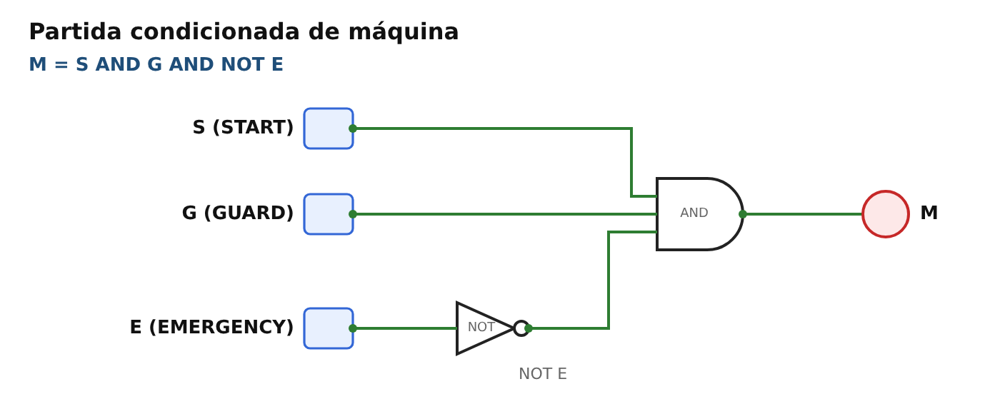
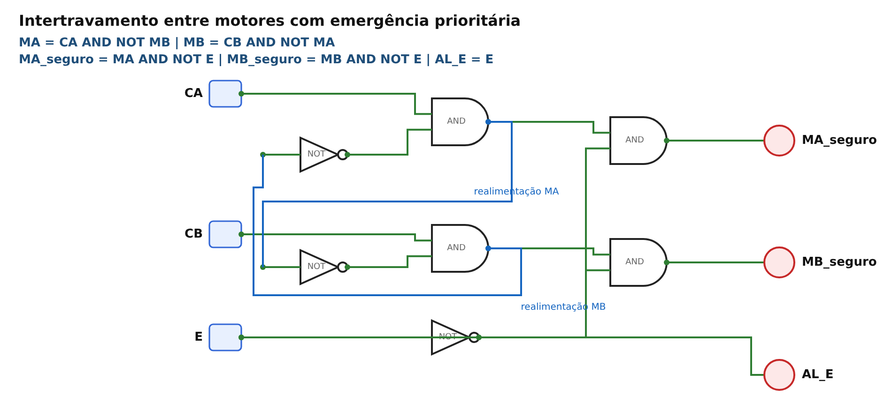
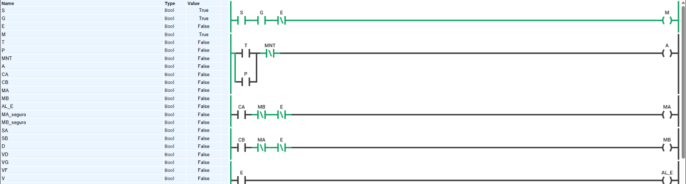
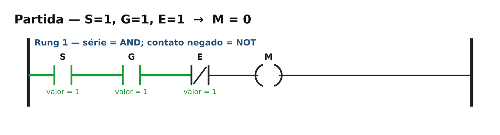
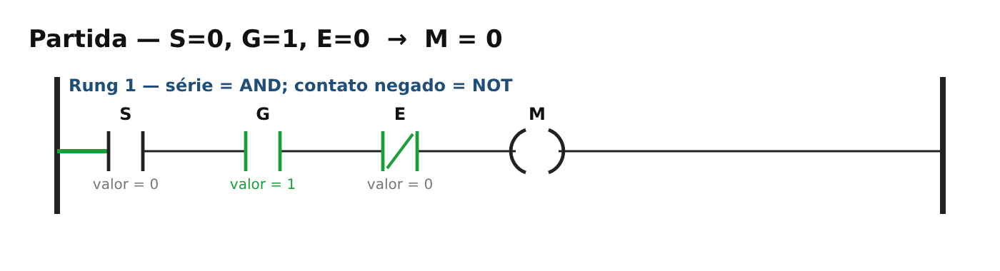
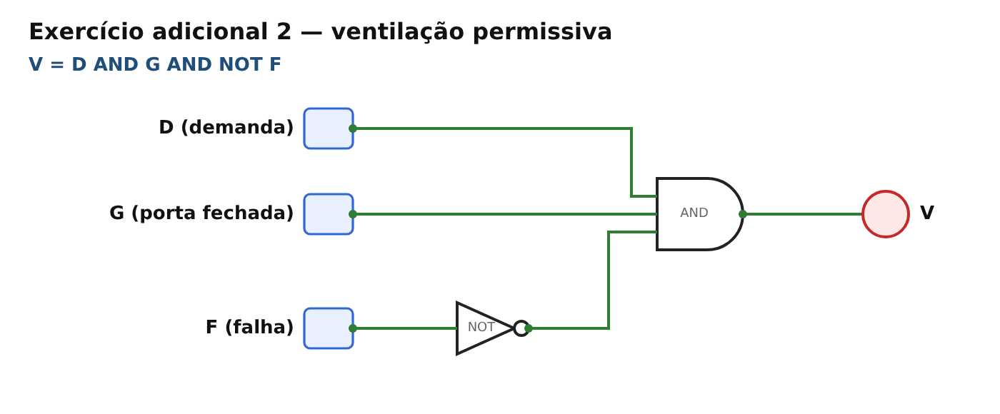
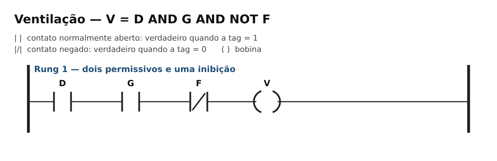
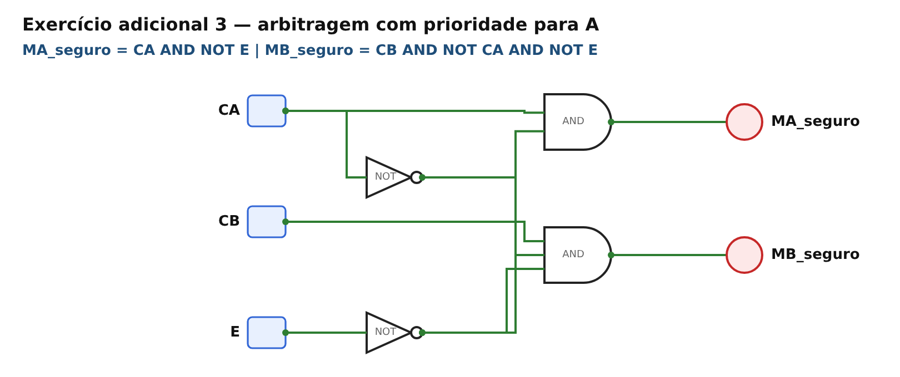
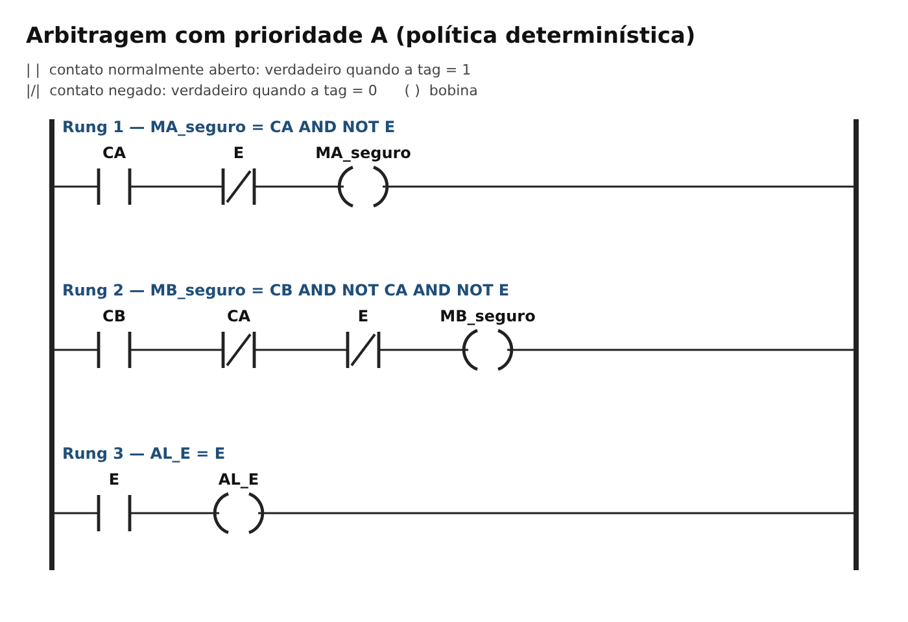

# Semana 04 — Sistemas discretos e lógica combinacional

**UC Sistemas Automatizados** · Prof. Calvetti · Engenharia de Software — USJT

**Aluno:** Gustavo Nunes Modesto
(RA 823126987) · 

**Data:** 13/10/2026

## Simulações

- CircuitVerse: [abrir circuito](https://circuitverse.org/users/473233/projects/2082396)
- PLC Simulator Online: [abrir Ladder](https://app.plcsimulator.online/xEyjH4qmKkzYcfsuWVCH)

## Estrutura

```
semana-04-logica/
├── README.md
├── casos_teste.csv          ← 57 casos: esperado, obtido e situação
├── circuitos/               ← diagramas de portas lógicas (referência para o CircuitVerse)
├── ladder/                  ← programas Ladder (referência para o PLC Simulator Online)
│   └── estado-*.png         ← estados importantes: partida, proteção aberta e emergência
└── capturas/                ← capturas dos simuladores
```

## Variáveis e convenções

Foi adotada a lógica positiva: **1 = proposição verdadeira**.

| Variável | 0 (FALSE) | 1 (TRUE) |
|---|---|---|
| S — START | botão liberado | botão pressionado |
| G — GUARD | proteção aberta | proteção fechada |
| E — EMERGENCY | não acionada | acionada |
| M — MOTOR | desenergizado | energizado (autorizado) |
| T / P | temperatura / pressão normal | temperatura / pressão alta |
| MNT | manutenção inativa | manutenção ativa |
| CA / CB | sem comando | comando do motor A / B |

A variável E = 1 indica emergência **acionada**. Por isso, nas condições de autorização, é utilizada como `NOT E`. Essa representação lógica não determina o tipo físico de contato (NA/NF) utilizado em um botão real.

Ordem de precedência adotada: NOT, depois AND e, por último, OR/XOR. Os parênteses foram utilizados para deixar as expressões explícitas.

## Expressões

| Saída | Expressão | Interpretação |
|---|---|---|
| M | `M = S AND G AND NOT E` | permite a partida somente com START, proteção fechada e ausência de emergência |
| A | `A = (T OR P) AND NOT MNT` | alarme por temperatura ou pressão, inibido durante a manutenção |
| MA, MB | `MA = CA AND NOT MB AND NOT E` · `MB = CB AND NOT MA AND NOT E` | intertravamento didático com emergência |
| AL_E | `AL_E = E` | alarme de emergência |
| D | `D = A XOR B = (A AND NOT B) OR (NOT A AND B)` | identifica divergência entre sensores |
| V | `V = D AND G AND NOT F` | condição permissiva para ventilação |
| MA_seguro, MB_seguro | `MA_seguro = CA AND NOT E` · `MB_seguro = CB AND NOT CA AND NOT E` | arbitragem com prioridade para o motor A |

## Teoria — Exercícios resolvidos

- **Alarme condicionado:** `A = (T OR P) AND NOT MNT`. Para T=0, P=1 e MNT=0, temos A=1. Já para T=1, P=0 e MNT=1, o resultado é A=0. A inibição do alarme durante a manutenção só deve ser utilizada quando houver justificativa na análise de risco.
- **Simplificação:** `Y = (A AND B) OR (A AND NOT B) = A AND (B OR NOT B) = A AND 1 = A`. Nesse caso, B não interfere no resultado. Se essa variável deveria influenciar a saída, é necessário revisar o requisito.
- **Teste de mutação:** a expressão incorreta `M = (S AND G) OR NOT E` apresenta falha quando S=0, G=0 e E=0, pois resulta em M=1 mesmo sem solicitação de partida e com a proteção aberta. A expressão correta é `M = S AND G AND NOT E`. Esse exemplo mostra a importância de testar todas as combinações da tabela-verdade, e não apenas o cenário de funcionamento normal.

## 1. CircuitVerse — Portas básicas e partida condicionada




**Como montar:** acesse <https://circuitverse.org/simulator> e crie um circuito em branco. Adicione um componente *Input* para cada variável, identificando-o com o nome da tag. Depois, insira as portas *AND / OR / NOT / XOR* e utilize *Output* ou *LED* para visualizar a saída.

Para a partida condicionada, aplique NOT na entrada E e utilize uma porta AND com 3 entradas (em *Properties*, configure *Input Size* = 3) ou duas portas AND em cascata.

Alterne as entradas entre 0 e 1, confira as saídas e registre os resultados. Para salvar, utilize *Save Online* e depois *Share* para obter o link público.

| Circuito | A | B | Esperado | Obtido | Situação |
|---|---|---|---|---|---|
| AND | 0 | 0 | 0 | 0 | PASSA |
| AND | 0 | 1 | 0 | 0 | PASSA |
| AND | 1 | 0 | 0 | 0 | PASSA |
| AND | 1 | 1 | 1 | 1 | PASSA |
| OR | 0 | 0 | 0 | 0 | PASSA |
| OR | 0 | 1 | 1 | 1 | PASSA |
| OR | 1 | 0 | 1 | 1 | PASSA |
| OR | 1 | 1 | 1 | 1 | PASSA |
| NOT | 0 | – | 1 | 1 | PASSA |
| NOT | 1 | – | 0 | 0 | PASSA |

### Partida condicionada — Tabela-verdade completa (2³ = 8 combinações)

| ID | S | G | E | NOT E | M esperado | M obtido | Situação |
|---|---:|---:|---:|---:|---:|---:|---|
| P01 | 0 | 0 | 0 | 1 | 0 | 0 | PASSA |
| P02 | 0 | 0 | 1 | 0 | 0 | 0 | PASSA |
| P03 | 0 | 1 | 0 | 1 | 0 | 0 | PASSA |
| P04 | 0 | 1 | 1 | 0 | 0 | 0 | PASSA |
| P05 | 1 | 0 | 0 | 1 | 0 | 0 | PASSA |
| P06 | 1 | 0 | 1 | 0 | 0 | 0 | PASSA |
| P07 | 1 | 1 | 0 | 1 | 1 | 1 | PASSA |
| P08 | 1 | 1 | 1 | 0 | 0 | 0 | PASSA |

Apenas a combinação **SGE = 110** permite o acionamento do motor.

## 2. Permissivo e alarme


| T | P | MNT | T OR P | NOT MNT | A esperado | A obtido | Situação |
|---|---|---|---|---|---|---|---|
| 0 | 0 | 0 | 0 | 1 | 0 | 0 | PASSA |
| 0 | 1 | 0 | 1 | 1 | 1 | 1 | PASSA |
| 1 | 0 | 0 | 1 | 1 | 1 | 1 | PASSA |
| 1 | 1 | 0 | 1 | 1 | 1 | 1 | PASSA |
| 0 | 0 | 1 | 0 | 0 | 0 | 0 | PASSA |
| 0 | 1 | 1 | 1 | 0 | 0 | 0 | PASSA |
| 1 | 0 | 1 | 1 | 0 | 0 | 0 | PASSA |
| 1 | 1 | 1 | 1 | 0 | 0 | 0 | PASSA |

## 3. Intertravamento entre motores e emergência prioritária



A lógica didática `MA = CA AND NOT MB` / `MB = CB AND NOT MA` utiliza as próprias saídas como realimentação. Por isso, o resultado depende do **estado anterior** e da **ordem de avaliação**.

Para o conflito CA = CB = 1, partindo do repouso, foi adotada a seguinte regra: **o rung de MA é avaliado primeiro**, dando prioridade ao motor A.

A emergência é incluída nas autorizações por meio de `AND NOT E` e também aciona diretamente o alarme com `AL_E = E`.

| Caso | CA | CB | MA ant. | MB ant. | Esperado | Obtido | Situação |
|---|---|---|---|---|---|---|---|
| I1 | 0 | 0 | 0 | 0 | MA=0; MB=0 | MA=0; MB=0 | PASSA |
| I2 | 1 | 0 | 0 | 0 | MA=1; MB=0 | MA=1; MB=0 | PASSA |
| I3 | 0 | 1 | 0 | 0 | MA=0; MB=1 | MA=0; MB=1 | PASSA |
| I4 | 1 | 1 | 1 | 0 | MA permanece prioritário | MA=1; MB=0 | PASSA |
| I5 | 1 | 1 | 0 | 1 | MB permanece prioritário | MA=0; MB=1 | PASSA |
| I6 | 1 | 1 | 0 | 0 | política definida (A primeiro) | MA=1; MB=0 | PASSA |

| Caso | Antes | Ação | Esperado | Obtido | Situação |
|---|---|---|---|---|---|
| E01 | motor desligado | E=1 | motores=0; AL_E=1 | MA=0; MB=0; AL_E=1 | PASSA |
| E02 | motor A ligado | E=1 | MA=0; AL_E=1 | MA=0; MB=0; AL_E=1 | PASSA |
| E03 | motor B ligado | E=1 | MB=0; AL_E=1 | MA=0; MB=0; AL_E=1 | PASSA |
| E04 | E=1 | CA=1 e CB=1 | MA=0; MB=0 | MA=0; MB=0; AL_E=1 | PASSA |
| E05 | E retorna a 0 | nenhum novo comando | não religar automaticamente | MA=0; MB=0 | PASSA |

Em todos os cenários, a condição `MA AND MB = 0` foi mantida.

A lógica combinacional desta semana não possui memória nem mecanismo de rearme. Na solução sequencial da Semana 6, será necessário um novo comando de partida após a emergência.

## 4. PLC Simulator Online — Reprodução em Ladder

| Representação | AND | OR | NOT | Saída |
|---|---|---|---|---|
| CircuitVerse | porta AND | porta OR | porta NOT | output/LED |
| Ladder | contatos em **série** | ramos em **paralelo** | contato **negado** `\|/\|` | bobina `( )` |


**Como montar:** acesse <https://plcsimulator.online/> e crie um diagrama em branco. Cadastre as variáveis booleanas S, G, E e M. No rung, coloque um contato NA de S, outro contato NA de G, um contato **negado** de E, todos em série, e a bobina M ao final.

Depois, inicie a simulação, alterne S, G e E nas 8 combinações possíveis e confira os resultados. Salve o programa e gere o link de acesso.

**Execução no simulador:** todos os circuitos foram reunidos em um único programa com 12 rungs no PLC Simulator Online, disponível no link inicial.

Para evitar conflitos entre nomes de variáveis, foram adotadas as seguintes identificações:

- Portas básicas: `IA`, `IB` → `Y1`, `Y2`, `Y3`.
- Divergência: `SA`, `SB` → `D`.
- Ventilação: `VD`, `VG`, `VF` → `V`.

Os circuitos de partida, alarme, intertravamento e arbitragem mantiveram suas tags originais. O intertravamento e a arbitragem compartilham os comandos `CA`, `CB` e `E`, mas utilizam saídas diferentes: `MA`/`MB` e `MA_seguro`/`MB_seguro`.

As 57 combinações documentadas em `casos_teste.csv` foram repetidas no simulador, apresentando os mesmos resultados registrados na coluna `conferido_plc_simulator`.



Estados de referência representados nos diagramas (verde = condição verdadeira / fluxo de energia lógica):

| P07 — partida autorizada | P08 — emergência | P03 — proteção aberta, sem START |
|---|---|---|
|  |  |  |

Outros programas Ladder: [`ladder/02-alarme-condicionado.png`](ladder/02-alarme-condicionado.png) e [`ladder/05-intertravamento-emergencia.png`](ladder/05-intertravamento-emergencia.png).

## 5. Exercícios adicionais

### 5.1 Alarme por divergência — `D = A XOR B`


| A | B | D esperado | D obtido | Interpretação |
|---|---|---|---|---|
| 0 | 0 | 0 | 0 | concordância em 0 |
| 0 | 1 | 1 | 1 | divergência |
| 1 | 0 | 1 | 1 | divergência |
| 1 | 1 | 0 | 0 | concordância em 1 |

**Limitação:** a concordância entre sensores não garante que ambos estejam corretos, pois podem apresentar a mesma falha. Da mesma forma, a divergência não permite identificar qual sensor está incorreto.

### 5.2 Ventilação permissiva — `V = D AND G AND NOT F`





| D | G | F | V esperado | V obtido | Situação |
|---|---|---|---|---|---|
| 0 | 0 | 0 | 0 | 0 | PASSA |
| 0 | 0 | 1 | 0 | 0 | PASSA |
| 0 | 1 | 0 | 0 | 0 | PASSA |
| 0 | 1 | 1 | 0 | 0 | PASSA |
| 1 | 0 | 0 | 0 | 0 | PASSA |
| 1 | 0 | 1 | 0 | 0 | PASSA |
| 1 | 1 | 0 | 1 | 1 | PASSA |
| 1 | 1 | 1 | 0 | 0 | PASSA |

**Teste de prioridade:** quando V = 1, alterar F para 1 faz com que V passe imediatamente para 0.

### 5.3 Arbitragem de motores — Política "A tem prioridade sobre B"





A arbitragem utiliza `MA = CA` e `MB = CB AND NOT CA`, eliminando a dependência circular do estado anterior.

Com a condição de emergência, as expressões são:

`MA_seguro = CA AND NOT E`

`MB_seguro = CB AND NOT CA AND NOT E`

| CA | CB | E | MA | MB | MA AND MB |
|---|---|---|---|---|---|
| 0 | 0 | 0 | 0 | 0 | 0 |
| 0 | 1 | 0 | 0 | 1 | 0 |
| 1 | 0 | 0 | 1 | 0 | 0 |
| 1 | 1 | 0 | 1 | 0 | 0 |
| qualquer | qualquer | 1 | 0 | 0 | 0 |

## Casos de teste

O arquivo [`casos_teste.csv`](casos_teste.csv) reúne os **57 casos de teste**, abrangendo portas básicas, partida, alarme, intertravamento, emergência, XOR, ventilação e arbitragem, incluindo as 8 combinações de CA/CB/E.

A coluna `obtido_modelo_ladder` registra os resultados da execução dos programas Ladder, analisados varredura a varredura.

Os 57 casos também foram repetidos no CircuitVerse (coluna `conferido_circuitverse`) e no PLC Simulator Online (coluna `conferido_plc_simulator`).

**Todos os 57 casos passaram.**

## Capturas

As capturas realizadas nos simuladores estão disponíveis na pasta `capturas/`.

| Arquivo | Estado |
|---|---|
| `circuitverse-visao-geral.png` | os 7 circuitos montados no CircuitVerse |
| `circuitverse-partida-P07.png` | S=1, G=1, E=0 → M=1 |
| `circuitverse-emergencia-P08.png` | S=1, G=1, E=1 → M=0 |
| `circuitverse-intertravamento-I6.png` | CA=1 e CB=1 a partir do repouso → só MA_seguro=1 |
| `ladder-partida-P07.png` | Ladder: S=1, G=1, E=0 → M=1 |
| `ladder-emergencia-P08.png` | Ladder: E=1 bloqueia M e ativa AL_E |
| `ladder-intertravamento.png` | Ladder: CA=1 e CB=1 → MA=1, MB=0 |

## Active recall

1. **Frase → lógica booleana:** definir as proposições binárias com clareza, traduzir "e" (AND), "ou" (OR) e "não" (NOT), utilizar parênteses, listar as 2ⁿ combinações possíveis e conferir cada resultado com o requisito.
2. **XOR em vez de OR:** utilizar XOR quando a saída deve indicar diferença ou exclusividade. Na porta OR, duas entradas em 1 produzem saída 1; na XOR, produzem 0.
3. **AND e OR em Ladder:** AND corresponde a contatos em série, OR a ramos em paralelo e NOT a um contato negado.
4. **Caso que revela `M = (S AND G) OR NOT E`:** com S=0, G=0 e E=0, o resultado é M=1, mesmo sem comando de partida e com a proteção aberta.
5. **Falha segura no protótipo:** uma emergência ou condição impeditiva faz com que as saídas de movimento sejam desativadas. Em um sistema real, o estado seguro deve ser definido por análise de risco.
6. **Evidência reproduzível:** links públicos, expressões utilizadas, convenções 0/1, tabelas completas com resultados esperados e obtidos, capturas dos estados relevantes e documentação no README.

## Conclusão e limites

As representações utilizadas — requisitos, expressões booleanas, tabelas-verdade, circuitos de portas e Ladder — apresentaram comportamento equivalente nas combinações analisadas.

O intertravamento com realimentação mostrou que comandos simultâneos podem produzir resultados diferentes conforme o estado anterior e a ordem de avaliação. Por esse motivo, foi definida uma política de prioridade para o motor A.

**Limitações:** a simulação de portas lógicas e programas Ladder demonstra o comportamento lógico, mas **não certifica uma função de segurança**.

A escolha dos componentes, arquitetura, diagnóstico, categoria e nível de desempenho, conforme ISO 13849 / IEC 62061, exige projeto e validação específicos. A simulação também não contempla falhas como contatos soldados, problemas de fiação ou tempo real de parada.
